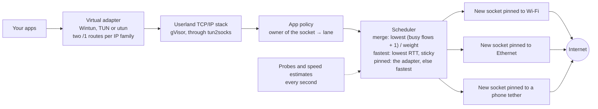

# Developing MergeLanes

Technical notes for people who want to build, change or understand MergeLanes. For installing and using it, see the [README](../README.md).

## Command line and flags

```
mergelanes on | off        start / pause merging in the running tray
mergelanes quit            pause and exit the tray
mergelanes status | list   live numbers / which adapters are used and why
mergelanes apps            the apps seen recently, their rule and their last lane
mergelanes app <app> <mode>   auto | merge | fastest | <adapter name>
mergelanes limit <adapter> <Mbit/s>
mergelanes autostart on|off|status
mergelanes tray            tray app (asks for admin once)
mergelanes run             system-wide in a console window
mergelanes socks           plain SOCKS5 proxy on 127.0.0.1:1080 (no admin, per-app)
mergelanes cleanup         remove leftover routes after a crash
mergelanes install         macOS only: sudo mergelanes install, lets the tray start without a password
mergelanes version
```

Flags for `tray`/`run`/`socks`: `-include "WiFi,Ethernet"` (only these adapters), `-weight "Name=3"`
(fixed weight instead of measured), `-ipv6 auto|on|off`, `-mtu 9000` (virtual adapter MTU, see below),
`-pprof 127.0.0.1:6060` (Go profiler, loopback only), `-log file`.

## How it works



The app's connection ends inside the userland stack. MergeLanes then opens a second connection to the real server from the chosen adapter and copies bytes between the two.

### Lanes (what MergeLanes adds to net-merge)

Every new flow gets a lane before it is dialed (`internal/apps`, `internal/engine/lane.go`):

- **Who owns it.** The flow's source is the app's own socket (the TUN's address and an ephemeral port).
  On Windows `GetExtendedTcpTable` / `GetExtendedUdpTable` name the owning PID, and
  `QueryFullProcessImageName` (or the process list, for protected processes such as anti-cheat games) the
  program. A table is read per protocol, both families at once (dual-stack sockets are listed as IPv6),
  and a flow only trusts a read that started after it arrived; flows that miss together share one read.
  Other OSes do not look up owners yet: every flow is an unknown app there, so only the auto rules apply.
- **Which lane.** A rule for the app (`apps.json`) wins: `merge`, `fastest`, or `adapter:<name>`. Without
  one (`auto`), UDP to any port except DNS, DHCP, NTP, NetBIOS, QUIC (443), DoQ, SSDP, WS-Discovery, mDNS
  and LLMNR counts as realtime (games, voice chat) and goes to the fastest lane; everything else is merged.
  Torrent clients and download managers are merged even in auto, since their UDP is bulk transfer.
- **Where it goes.** `merge` is net-merge's balancer. `fastest` is the adapter with the lowest smoothed
  RTT (the probe's TCP handshake to 1.1.1.1 / 8.8.8.8, 0.7/0.3 EWMA); it is sticky and only moves when
  another adapter is under 0.75x of the current one's RTT, or the current one drops out of the best health
  tier, so a game's flows do not hop between links. `pinned` uses the named adapter while it is present
  and not down, and otherwise the fastest of the rest; a dial failure on it also falls back.
- Open flows never move: a rule changes where new flows go.

### Windows privileges

The tray is elevated and driven by the signed-in user, so everything it writes, deletes or reads back is
in `%ProgramData%\MergeLanes` (`platform.SecureDir`): owned by Administrators, writable only by SYSTEM
and Administrators, readable by Users. A junction, symlink or file planted there is removed (never
followed) and a folder someone else created is renamed aside, and the access list is reset on every
start. `ctl\` lets Users add files only (no folders); requests there are opened without following
links and capped at 4 KiB. System tools run by their full path in System32. *Start at sign-in* refuses a
copy outside Program Files.

### Design trade-offs

- **End each TCP connection and re-dial it, instead of forwarding packets.** A server accepts one sender per connection, so this is the only way to use several links without a server of our own. The cost: one connection never gets faster than one link. Speed comes from many connections.
- **Refuse IPv6 when the adapters differ.** Apps prefer IPv6, so allowing it would send everything to the few adapters that have it. In `auto` mode new IPv6 connections are refused at the first packet and apps fall back to IPv4 at once. The cost: IPv6-only hosts are unreachable until every adapter has IPv6, or until the setting is changed.
- **No speed tests.** Weights come from the traffic that already flows. The cost: a link is measured only while it carries traffic, so an idle estimate can only recover up to half of the best link's speed.

- ON creates a virtual adapter `mergelanes` (Wintun on Windows, a kernel TUN on Linux, a utun on macOS) and two `/1` routes per IP family that beat the default route
  without touching it. OFF deletes them. If the process dies the adapter and routes die with it, so a
  crash can't leave the machine without internet.
- Flows entering the TUN are terminated in a userland TCP/IP stack (tun2socks/gVisor) and re-dialed from
  a chosen adapter: the socket is bound to that adapter's source IP and forced out of it with
  `IP_UNICAST_IF` (Windows), `SO_BINDTOIFINDEX` (Linux) or `IP_BOUND_IF` (macOS, plus a scoped default route per adapter so the bound lookup still works), so it can never loop back into the TUN.
- The virtual adapter runs at MTU 9000 (both the OS and the userland stack). Its traffic never leaves
  the machine, so the links' 1500 doesn't apply, and bigger packets cost far less CPU: measured about
  3x less CPU per Mbit/s than at 1500 (0.18 vs 0.54 cores per 100 Mbit/s). `-mtu` changes it.
- Adapters are detected automatically and re-scanned every 3 s. Only real hardware with a default route
  is used (on Linux: interfaces backed by a device in sysfs, with a default route in any routing table; on macOS: `enN` interfaces and TetherKit's `fethN`, with a default route): tunnels, VPNs (Tailscale, WireGuard, ...), virtual switches and LAN-only adapters are skipped
  (`mergelanes list` shows why).
- Each adapter and each address family is probed for real internet access. A tether with no data or a
  captive-portal Wi-Fi gets no flows; a recovered link rejoins within seconds.
- Automatic balancing sends flows to the adapter with the lowest (busy flows + 1) / weight,
  discounting TCP sockets with no data for two seconds. Connecting sockets still count as busy.
  Weights update every second from smoothed throughput estimates, separately for IPv4 and IPv6
  (a link can be fast over native IPv6 and slow over translated IPv4). Idle low estimates
  recover up to half the best link's capacity, never to equal preference. Address changes
  reset the affected family's estimate. Static weights retain least-open-flows scheduling;
  scheduling respects health filtering, cooldowns and retry exclusions. Existing flows
  stay pinned to their original adapter; no background speed tests are used.
- IPv6 (`-ipv6 auto|on|off`, tray checkbox): IPv6 flows can only leave through adapters that have IPv6, and
  apps that prefer IPv6 (browsers, OBS, curl) would funnel everything onto them. In `auto` mode IPv6 is
  balanced only when every adapter has working IPv6; otherwise new IPv6 connections are refused at the SYN
  (UDP gets ICMP unreachable), apps fall back to IPv4 instantly, and IPv4 spreads over all adapters.
  Cost: IPv6-only hosts are unreachable while the adapters differ (untick the tray box or use `-ipv6 on`).

## Build

Needs Go (see `go.mod`) and, for the Windows installer, [Inno Setup 6](https://jrsoftware.org/isinfo.php).

```
go test ./...                       # uses loopback aliases as fake adapters; no second link needed
go build -o mergelanes ./cmd/mergelanes   # Linux, macOS (macOS needs the Xcode command line tools)
scripts\build.ps1 -Version 0.1.0    # dist\: mergelanes.exe, mergelanes-tray.exe, installer, portable zip
```

`wintun.dll` is not in the repo: `scripts\fetch-wintun.ps1` downloads it and verifies its SHA-256 and its
WireGuard LLC signature. To run from source, put it next to the exe:

```
go build -o mergelanes.exe .\cmd\mergelanes
scripts\fetch-wintun.ps1 -OutDir .
```

Releases are built by GitHub Actions when a `vX.Y.Z` tag is pushed (`.github/workflows/release.yml`).
Add the version's section to `CHANGELOG.md` first: it becomes the release notes, and the release fails
without it (`scripts\release-notes.ps1 -Version X.Y.Z` previews them).
Layout: `cmd/mergelanes` is the command line; `internal/engine` the scheduler, lanes, balancer, probes and
SOCKS5 front-end; `internal/apps` the per-app policy and socket owner lookup; `internal/state` the state
folder, status, limits and app rules; `internal/nics` adapter discovery, counters and egress pinning; `internal/tun` the
system-wide front-end; `internal/tray` the tray icon; `internal/platform` privileges, single instance
and autostart. OS-specific code lives in `_windows.go` / `_linux.go` / `_darwin.go` files next to the shared code.

`go test -run xxx -bench Relay ./...` measures the relay data path (about 3 GB/s over loopback).

Don't benchmark against speed.cloudflare.com repeatedly: it rate-limits the IP (HTTP 429) after a few
large downloads and the numbers become meaningless.
